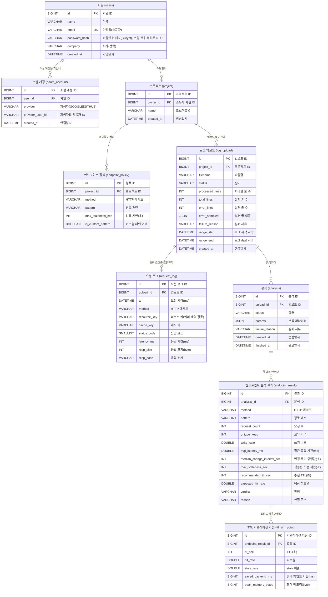

# TTL Advisor — v1 설계

API 액세스 로그를 분석해 엔드포인트별 Redis TTL을 추천하는 서비스.

## 1. 범위

- **v1 포함**: 회원가입·로그인(이메일, Google, GitHub) → 로그 업로드 → 엔드포인트별 분석 → TTL별 히트율 시뮬레이션 → 추천 TTL + 근거 리포트
- **v1 제외 (v2+)**: 실시간 수집 SDK, 실제 Redis 연동/자동 TTL 적용, nginx 로그 포맷,
  이메일 인증·비밀번호 재설정·로그인 유지, 이메일 계정과 소셜 계정 연결, 팀·프로젝트 공유, 회원 탈퇴

> 공개 서비스로 운영하기 위해 회원·인증을 v1에 넣었다 (처음 설계에서는 v2였다).
> 인증이 없으면 누구나 다른 사람의 프로젝트와 로그를 보고 지울 수 있다.

## 2. 아키텍처

```
[React + TS (Vite)]
      │  REST (/api), 작업 상태는 폴링
      ▼
[Spring Boot API]
  ├ auth     : 회원가입·로그인 (Spring Security, 세션 쿠키, Google·GitHub OAuth2) → 모든 API는 로그인 사용자 기준
  ├ ingest   : 업로드 → 파싱 → 경로 정규화 → MySQL 배치 저장 (비동기)
  └ analysis : 저장된 로그로 TTL 시뮬레이션 → 추천 계산 → 결과 저장 (비동기)
      │
      ▼
[MySQL 8]  회원·세션 + 원시 요청 로그 + 분석 결과
```

- 비동기 처리: `@Async` + `ThreadPoolTaskExecutor` (v1은 메시지 큐 없음)
- Redis는 추천 대상일 뿐, v1 런타임 구성에는 포함하지 않음

## 3. 핵심 개념

| 용어 | 의미 | 예시 |
|---|---|---|
| 패턴 (pattern) | 분석·추천 단위 | `GET /users/:id` |
| 캐시 키 (cache key) | 실제 캐시 항목 하나 | `GET /users/123?lang=ko` (쿼리 파라미터 정렬) |
| 리소스 키 (resource key) | 쓰기 무효화 매칭 단위. 쿼리를 뺀 경로 | `/users/123` |

경로 정규화 규칙:
- 숫자 세그먼트 → `:id`, UUID → `:uuid`, 16자 이상 hex → `:hash`
- 사용자가 등록한 커스텀 패턴이 자동 규칙보다 우선
- 패턴은 **분석 시점에** 계산한다 (DB에 저장하지 않음). 커스텀 패턴을 바꾸고 재분석하면 업로드 없이 바로 반영된다

## 4. 입력 로그 포맷 (JSON Lines)

```json
{"ts":"2026-11-23T10:00:00.123Z","method":"GET","path":"/users/123?lang=ko","status":200,"latencyMs":42,"size":1830,"respHash":"a1b2c3"}
```

| 필드 | 필수 | 설명 |
|---|---|---|
| ts | O | ISO-8601, 밀리초 |
| method | O | HTTP 메서드 |
| path | O | 쿼리 포함 경로 |
| status | O | 응답 코드 (GET 2xx만 캐시 대상으로 분석) |
| latencyMs | - | 백엔드 응답 시간 (절감 효과 계산) |
| size | - | 응답 크기 (메모리 추정) |
| respHash | - | 응답 바디 해시. 있으면 실제 데이터 변경을 감지해 stale 비율을 정확히 계산 |

`respHash`가 없으면 같은 리소스에 대한 쓰기 요청(POST/PUT/PATCH/DELETE)을 변경 시점으로 간주한다.

### 파서 입력 검증 규칙

- 한 줄에 JSON 객체 하나를 받는다. 첫 줄 앞의 UTF-8 BOM은 무시한다. 중복 필드, 한 줄에 여러 값, 빈 줄은 실패로 센다. 알 수 없는 필드는 무시한다.
- `ts`는 `Z` 또는 UTC 오프셋이 있는 ISO-8601 시각이다. UTC로 변환한 뒤 1000~9999년 범위에서 밀리초 단위로 손실 없이 표현할 수 있어야 한다.
- `method`는 1~10자 HTTP 토큰이다. `path`는 `/`로 시작하는 500자 이하 경로이며 (캐시 키 "메서드 공백 경로"가 512자 컬럼에 들어가도록), 공백, 제어 문자, 프래그먼트를 허용하지 않는다. 메서드의 대소문자와 경로·쿼리의 순서는 원문 그대로 전달한다.
- `status`는 100~599 사이의 JSON 정수다. `latencyMs`와 `size`는 0 이상인 32비트 정수이며, `respHash`는 비어 있지 않고 제어 문자가 없는 64자 이하 문자열이다. 선택 필드의 생략과 `null`을 허용한다.
- 처음 1,000줄에서 실패율이 90% 이상이면 읽기를 중단한다. 짧은 입력은 실제 줄 수를 기준으로 판단하며, 0줄도 형식 오류로 처리한다. 실패 샘플에는 처음 20개의 1부터 시작하는 줄 번호와 고정된 사유만 기록한다.
- 유효한 로그는 한 줄씩 호출자에게 전달한다. B7에서 저장을 연결할 때 형식 오류가 확정되면 해당 업로드에 이미 적재한 행을 정리한다.

## 5. 분석 알고리즘

준비:
- 분석 시작 시 프로젝트 정책(커스텀 패턴, 허용 staleness)을 `analysis.params`에 **스냅샷**으로 저장하고 이 값만 사용한다 (분석 중·후 정책 변경의 영향 없음)
- 업로드의 요청 로그를 `ts` 순으로 스트리밍하며 패턴을 계산하고 캐시 키별로 그룹화
- 후보 TTL `[1, 5, 10, 30, 60, 120, 300, 600, 1800, 3600, 21600, 86400]`초 중 **로그 기간의 절반을 넘는 값은 제외**하고, 제외 사실을 결과 `reason`에 남긴다

패턴마다, 남은 후보 TTL 각각에 대해:

1. 캐시 키별로 요청을 시간순으로 재생
2. 첫 요청은 miss → 캐시에 저장, 만료 시각 = 현재 + TTL
3. 만료 전 같은 키 요청은 hit. 단, 그 사이 **같은 리소스 키**에 쓰기가 있었으면 무효화되어 miss
   (예: `PUT /products/123`은 `GET /products/123?lang=ko` 캐시를 무효화)
4. hit인데 `respHash`가 캐시된 값과 다르면 stale hit

TTL별 지표:
- `hitRate`, `staleRate`
- `savedBackendMs` — hit 요청 latency 합
- `peakMemoryBytes` — 동시 생존 키 수 최대값 × 평균 응답 크기

추천 규칙:
1. 후보를 `TTL ≤ maxStaleness`(사용자 설정) 이고 `staleRate ≤ 1%` 로 필터
2. 남은 후보 중 최대 히트율의 90%에 처음 도달하는 가장 작은 TTL (곡선의 knee)

판정 (verdict):
- `CACHE` — 위 규칙으로 추천 TTL 결정
- `DONT_CACHE` — 최대 히트율 < 10% 또는 쓰기 비중이 높음
- `INSUFFICIENT_DATA` — 요청 수 부족

## 6. 회원·인증

### 방식: 서버 세션 + HttpOnly 쿠키

- 이름·이메일·비밀번호·비밀번호 확인·회사(선택)로 가입하고, 이메일 + 비밀번호로 로그인한다. 비밀번호는 BCrypt 해시로만 저장한다
- Google·GitHub 계정으로도 가입·로그인할 수 있다 (아래 "소셜 로그인")
- 로그인하면 서버가 세션을 만들고 `SESSION` 쿠키(HttpOnly, SameSite=Lax, HTTPS면 Secure)를 내려준다.
  쿠키 속성은 `CookieSerializer` 빈으로 직접 정한다. 정하지 않으면 서블릿 컨테이너 설정을 따라가 HttpOnly가 빠질 수 있다
- 운영에서는 nginx가 HTTPS를 끝내고 HTTP로 넘긴다. `server.forward-headers-strategy=native`로 `X-Forwarded-Proto`를 읽어야
  백엔드가 원래 요청이 HTTPS였음을 알고 쿠키에 Secure를 붙인다. native는 내부 IP 대역 프록시의 헤더만 믿는다
- 세션은 **Spring Session JDBC**로 MySQL에 저장한다. 서버를 재시작하거나 여러 대로 늘려도 로그인이 유지된다
- 세션 만료: 마지막 요청 후 30분. 분석 폴링 중에는 계속 연장된다
- 로그인 성공 시 세션 ID를 새로 발급한다 (세션 고정 공격 방지, Spring Security 기본 동작)

**JWT를 쓰지 않는 이유**

| 기준 | 서버 세션 (선택) | JWT |
|---|---|---|
| 배포 구조 | 프론트와 API가 같은 도메인(nginx가 `/api` 프록시)이라 쿠키가 그대로 동작 | 다른 도메인·모바일 앱일 때 유리하지만 해당 없음 |
| 토큰 보관 | HttpOnly 쿠키라 JS에서 읽을 수 없음 (XSS로 탈취 불가) | localStorage에 두면 XSS에 노출, 쿠키에 두면 세션과 같은 CSRF 대응 필요 |
| 로그아웃·강제 만료 | 세션 행을 지우면 즉시 끝남 | 만료 전 무효화하려면 블랙리스트 저장소가 필요 |
| 비용 | 요청마다 세션 조회 1번 (MySQL, 인덱스 조회) | 없음 |

### 소셜 로그인 (Google, GitHub)

- Spring Security `oauth2Login`으로 처리한다. 로그인에 성공하면 이메일 로그인과 똑같이 서버 세션이 만들어진다 (이후 흐름 동일)
- 경로를 `/api` 아래로 옮겨 nginx 프록시 규칙 하나로 처리한다
  - 시작: `GET /api/auth/oauth2/authorization/{google|github}` (브라우저 이동, fetch 아님)
  - 콜백: `GET /api/auth/oauth2/callback/{google|github}` (각 제공자 콘솔에 이 주소를 등록)
- 성공하면 프론트 `/`(또는 로그인 전에 가려던 화면)로, 실패하면 `/login?error=코드`로 이동한다
- OAuth 요청 위조는 `state` 파라미터로 막는다 (Spring Security 기본). `SESSION` 쿠키가 SameSite=Lax라 제공자에서 돌아오는 GET 이동에도 쿠키가 실린다
- 클라이언트 ID·시크릿은 환경 변수(`GOOGLE_CLIENT_ID`, `GOOGLE_CLIENT_SECRET`, `GITHUB_CLIENT_ID`, `GITHUB_CLIENT_SECRET`)로 주입한다. 값이 없으면 해당 버튼을 숨긴다

**사용자 식별과 가입**

| 항목 | 규칙 |
|---|---|
| 식별 기준 | 제공자의 사용자 ID(`oauth_account.provider_user_id`). 이메일은 제공자 쪽에서 바뀔 수 있어 식별에 쓰지 않는다 |
| 첫 로그인 | 회원을 자동으로 만든다. 이름은 제공자 이름(GitHub은 없으면 로그인 ID), 회사는 `null`, 비밀번호는 없음 |
| 이메일 | Google은 `email_verified=true`일 때만, GitHub은 `/user/emails`의 인증된 기본 이메일(`user:email` 권한)만 받는다. 없으면 실패(`OAUTH_EMAIL_UNVERIFIED`) |
| 같은 이메일의 기존 회원 | **자동으로 합치지 않고 실패**(`EMAIL_ALREADY_REGISTERED`). 원래 방법으로 로그인하라고 안내 |
| 비밀번호 없는 회원 | 이메일·비밀번호 로그인은 `INVALID_CREDENTIALS` (일반 실패와 같은 응답) |

**같은 이메일을 자동으로 합치지 않는 이유**: v1은 이메일 인증이 없어서, 공격자가 남의 이메일로 비밀번호 계정을 먼저 만들 수 있다.
피해자가 나중에 Google로 로그인했을 때 그 계정에 합쳐 주면, 공격자는 자기가 정한 비밀번호로 피해자 계정에 계속 들어올 수 있다(사전 계정 탈취).
이메일 인증과 로그인 상태에서의 계정 연결은 v2에서 함께 다룬다.

### CSRF

쿠키로 인증하므로 CSRF 방어가 필요하다.

- Spring Security CSRF 보호를 켜고, 토큰을 `XSRF-TOKEN` 쿠키(JS에서 읽을 수 있음)로 내려준다
- 프론트는 `POST`/`PUT`/`PATCH`/`DELETE` 요청에 쿠키 값을 `X-XSRF-TOKEN` 헤더로 붙인다 (`apiFetch` 한 곳에서 처리)
- 앱 시작 시 `GET /api/auth/me`를 호출해 로그인 여부를 확인하고 CSRF 쿠키를 받는다
- Spring Security는 토큰을 읽을 때까지 만들지 않으므로(지연 로딩), 매 요청 토큰을 읽는 `CsrfCookieFilter`를 둔다. 없으면 GET만 하는 SPA는 쿠키를 받지 못한다
- 로그인 성공 시 CSRF 토큰도 새로 발급한다
- 로그인·회원가입 요청도 CSRF 검사 대상이다 (로그인 CSRF 방지)

### 권한: 프로젝트 소유자만 접근

- 프로젝트는 만든 사용자(`project.owner_id`)만 보고 바꿀 수 있다. 업로드·정책·분석은 모두 프로젝트를 거쳐 소유자를 확인한다
  (`/api/uploads/{id}`, `/api/analyses/{id}`처럼 프로젝트 ID가 경로에 없는 API도 조인으로 소유자를 확인)
- 다른 사용자의 리소스는 **403이 아니라 404**로 응답한다. 403이면 해당 ID가 존재한다는 사실이 드러난다
- 목록 API는 로그인 사용자의 프로젝트만 반환한다
- 로그인하지 않은 요청은 `/api/auth/signup`, `/api/auth/login`, `/api/auth/me`, `/api/auth/oauth2/**`를 제외하고 모두 401
  - 단, 쓰기 요청은 CSRF 검사가 먼저라 토큰이 없으면 403 `CSRF_TOKEN_INVALID`가 먼저 온다. 프론트는 토큰을 다시 받아 재시도하므로 결국 401을 받는다

### 가입·로그인 규칙

| 항목 | 규칙 |
|---|---|
| 이름 | 필수, 앞뒤 공백 제거 후 1~50자 |
| 이메일 | 형식 검사, 최대 255자, 소문자로 정규화해 저장, 중복 불가(DB `UNIQUE`) |
| 비밀번호 | 8~64자, 공백만으로 된 값 불가, UTF-8 72바이트 이하 (BCrypt가 앞 72바이트만 쓰기 때문. 한글은 24자까지) |
| 비밀번호 확인 | 프론트에서만 비밀번호와 같은지 검사하고 서버로 보내지 않는다 (서버가 받아도 검증할 정보가 늘지 않음) |
| 회사 | 선택, 앞뒤 공백 제거 후 최대 100자. 빈 값은 `null`로 저장 |
| 가입 후 | 바로 로그인 상태가 된다 |
| 로그인 실패 메시지 | 이메일이 없을 때와 비밀번호가 틀렸을 때 같은 메시지. 없는 이메일도 더미 해시와 비교해 응답 시간 차이를 줄인다 |
| 가입 여부 노출 범위 | 로그인으로는 알 수 없다. 회원가입의 409 `EMAIL_ALREADY_EXISTS`로는 알 수 있다 ("이미 가입된 이메일"을 알려 주지 않으면 사용자가 가입 실패 이유를 모른다). 대부분의 서비스가 받아들이는 절충이며, 대량 확인은 v2의 요청 횟수 제한으로 막는다 |
| 로그인 시도 제한 | v2 (IP·계정별 실패 횟수 제한) |

## 7. 데이터 모델 (MySQL 8)

스키마는 **Flyway**로 관리한다 (`backend/src/main/resources/db/migration/V1__init.sql` 부터 시작).
JPA는 `ddl-auto=validate` 로 두어 엔티티와 실제 스키마 불일치를 시작 시점에 잡는다.

```
users              (id, name, email, password_hash NULL, company, created_at)
                    UNIQUE (email)
oauth_account      (id, user_id, provider[GOOGLE|GITHUB], provider_user_id, created_at)
                    UNIQUE (provider, provider_user_id)
project            (id, owner_id, name, created_at)
                    INDEX (owner_id, created_at)
endpoint_policy    (id, project_id, method, pattern, max_staleness_sec, is_custom_pattern)
                    UNIQUE (project_id, method, pattern)
log_upload         (id, project_id, filename, status[UPLOADED|PARSING|PARSED|FAILED],
                    processed_lines, total_lines, error_lines, error_samples JSON,
                    failure_reason, range_start, range_end, created_at)
request_log        (id, upload_id, ts DATETIME(3), method, resource_key, cache_key,
                    status_code, latency_ms, resp_size, resp_hash)
                    INDEX (upload_id, ts)
analysis           (id, upload_id, status[PENDING|RUNNING|DONE|FAILED], params JSON,
                    failure_reason, created_at, finished_at)
endpoint_result    (id, analysis_id, method, pattern, request_count, unique_keys,
                    write_ratio, avg_latency_ms, median_change_interval_sec,
                    max_staleness_sec, recommended_ttl_sec, expected_hit_rate,
                    verdict, reason)
ttl_sim_point      (id, endpoint_result_id, ttl_sec, hit_rate, stale_rate,
                    saved_backend_ms, peak_memory_bytes)
```

### ERD



- `request_log` 적재는 JPA 대신 `JdbcTemplate` 배치 insert (대량 데이터)
- `request_log` 인덱스는 `(upload_id, ts)` 하나. 분석은 업로드 전체를 시간순으로 스트리밍하므로 충분하고,
  긴 문자열 컬럼(`cache_key` 512자)을 인덱스에 넣지 않아 utf8mb4 키 길이 한도(3072바이트) 문제를 피한다
- `endpoint_policy`의 `UNIQUE (project_id, method, pattern)`으로 정책 중복을 DB에서 막는다
- 업로드 1회 제한: 100MB(동기 검사, 413) / 100만 줄(파싱 중 검사, 초과 시 `FAILED`)
- 삭제: 프로젝트 삭제 시 요청 로그는 `upload_id` 단위로 1만 건씩 배치 삭제한다 (FK 연쇄 삭제에 의존하지 않음).
  파싱·분석이 진행 중인 프로젝트는 삭제할 수 없다 (409)
- FK 규칙: `request_log → log_upload`만 CASCADE 없음(대량 연쇄 삭제 방지, 먼저 지우지 않으면 삭제 실패). 나머지 FK는 `ON DELETE CASCADE`
- `request_log`는 JPA 엔티티를 두지 않는다 (JdbcTemplate 전용)
- 회원 관련 마이그레이션은 이슈별로 나눈다
  - `V2__users_and_sessions.sql` (B16): `users`, Spring Session 테이블(`SPRING_SESSION`, `SPRING_SESSION_ATTRIBUTES`).
    세션 스키마도 Flyway 한 곳에서 관리하므로 `spring.session.jdbc.initialize-schema=never`
  - `V3__project_owner.sql` (B17): `project.owner_id` (`NOT NULL`, FK `ON DELETE` 없음), 인덱스 `(owner_id, created_at)`.
    로그인 기능 전에 만든 소유자 없는 프로젝트는 가장 먼저 가입한 회원에게 준다 (개발 DB 데이터를 지우지 않기 위해).
    회원이 없는데 프로젝트가 있으면 NOT NULL 단계에서 실패해 마이그레이션이 멈춘다
  - V4 (B18): `oauth_account`
- `project.owner_id` FK에 CASCADE를 두지 않는다. 회원 탈퇴(v2)는 프로젝트 삭제와 같은 배치 삭제 절차를 거쳐야 한다

## 8. REST API

요청·응답 형식, 에러 코드 등 상세는 [API.md](API.md) 참고.

```
POST   /api/auth/signup                            회원가입 (가입 후 로그인 상태)
POST   /api/auth/login                             로그인
POST   /api/auth/logout                            로그아웃
GET    /api/auth/me                                로그인 사용자 조회 (+ CSRF 쿠키 발급)
GET    /api/auth/oauth2/authorization/{provider}   Google·GitHub 로그인 시작 (브라우저 이동)
GET    /api/auth/oauth2/callback/{provider}        제공자 콜백 (Spring Security 처리)
POST   /api/projects                               프로젝트 생성
GET    /api/projects                               프로젝트 목록
GET    /api/projects/{projectId}                   프로젝트 조회
DELETE /api/projects/{projectId}                   프로젝트 삭제
POST   /api/projects/{projectId}/uploads           로그 업로드 (multipart) → 202
GET    /api/projects/{projectId}/uploads           업로드 목록
GET    /api/uploads/{uploadId}                     업로드 상태 조회
GET    /api/projects/{projectId}/policies          정책 목록
PUT    /api/projects/{projectId}/policies          정책 일괄 저장
POST   /api/uploads/{uploadId}/analyses            분석 실행 → 202
GET    /api/uploads/{uploadId}/analyses            분석 목록
GET    /api/analyses/{analysisId}                  분석 결과 (대시보드)
GET    /api/analyses/{analysisId}/endpoints/{id}   엔드포인트 상세 (곡선)
GET    /api/analyses/{analysisId}/export           추천 설정 내보내기
```

## 9. 백엔드 구조

- Java 21, Spring Boot 4.1, Gradle 9
- Spring Data JPA + JdbcTemplate, Flyway, MySQL Connector/J
- Spring Security(세션 인증, CSRF, OAuth2 Client), Spring Session JDBC
- 테스트: `TtlSimulator`/`TtlRecommender` 단위 테스트, Testcontainers(MySQL) 통합 테스트

도메인별로 패키지를 나누고, 각 도메인 안을 다시 계층별로 나눈다. 여러 도메인이 함께 쓰는 설정과 예외 처리는 `config/`, `global/`에 둔다.

```
backend/src/main/java/com/ttladvisor/
 ├ user/              회원·인증 (User, OAuthAccount, AuthController, UserService ...)
 ├ project/           프로젝트와 엔드포인트 정책
 │  ├ controller/        ProjectController
 │  ├ service/           ProjectService
 │  ├ repository/        ProjectRepository, ProjectSummary(조회 프로젝션)
 │  ├ domain/
 │  │  ├ entity/         Project, EndpointPolicy
 │  │  └ enums/
 │  └ dto/
 │     ├ request/        CreateProjectRequest
 │     └ response/       ProjectResponse, ProjectSummaryResponse
 ├ upload/            로그 업로드·파싱 (LogUpload, UploadStatus, LogUploadRepository,
 │                    RequestLogJdbcRepository, JsonLinesParser, PathNormalizer ...)
 ├ analysis/          TTL 분석 (Analysis, EndpointResult, TtlSimPoint, AnalysisStatus, Verdict,
 │                    AnalysisRepository, TtlSimulator, TtlRecommender ...)
 ├ config/            설정 (AppProperties, AsyncConfig, JacksonConfig, TimeConfig, WebConfig, SecurityConfig)
 └ global/
    ├ error/          에러 코드, ApiException, 에러 응답, GlobalExceptionHandler
    └ security/       401·CSRF 응답 처리, OAuth2 성공·실패 핸들러, 현재 사용자 조회
```

- 모든 도메인(`user`, `project`, `upload`, `analysis`)은 `project/`와 같은 하위 구조(`controller`, `service`, `repository`, `domain/entity`, `domain/enums`, `dto/request`, `dto/response`)를 쓴다. 클래스가 없는 하위 패키지는 만들지 않는다
- 파서·시뮬레이터처럼 컨트롤러·리포지토리가 아닌 로직은 해당 도메인의 `service/`에 둔다
- 다른 도메인의 엔티티·리포지토리는 직접 참조할 수 있지만, 쓰기는 그 도메인의 서비스를 거친다
- enum 패키지 이름은 `enums`다. `enum`은 Java 예약어라 패키지 이름으로 쓸 수 없다
- DTO의 정적 팩토리(`from`)는 컨트롤러가 다른 패키지에서 부르므로 `public`으로 둔다
- 테스트도 같은 패키지 구조를 따른다 (`project/controller/ProjectApiTest`, `upload/repository/RequestLogJdbcRepositoryTest` ...)

```
backend/src/main/resources/
 ├ application.yml
 └ db/migration/V1__init.sql, V2__users_and_sessions.sql, ...
```

## 10. 프론트엔드 구조

- Vite + React + TypeScript, React Router, TanStack Query(폴링), Recharts

화면:
0. 로그인 / 회원가입 — 이메일 폼 + "Google로 계속하기"·"GitHub로 계속하기" 버튼. 로그인하지 않으면 다른 화면 대신 로그인으로 이동, 로그인 후 원래 가려던 화면으로 복귀
1. 프로젝트 목록 / 생성
2. 로그 업로드 — 드래그앤드롭, 파싱 진행률
3. 분석 대시보드 — 엔드포인트별 요청 수, 쓰기 비율, 추천 TTL, 예상 히트율, 판정 표
4. 엔드포인트 상세 — TTL별 히트율·stale 곡선, 추천 지점 표시, 허용 staleness 슬라이더
   (곡선 포인트를 이미 받아오므로 서버 재요청 없이 클라이언트에서 추천값 재계산)

## 11. 저장소 / Docker 구성

```
TTL개인프로젝트/
 ├ backend/          멀티스테이지 Dockerfile (Gradle 빌드 → JRE)
 ├ frontend/         빌드 → nginx 정적 서빙, /api 는 backend로 프록시
 ├ tools/loggen/     Zipf 분포 기반 샘플 트래픽 로그 생성기 (Node + TS)
 ├ docs/DESIGN.md
 └ docker-compose.yml   mysql, backend, frontend
```

- 개발 시: MySQL만 Docker, 백엔드·프론트는 로컬 실행
- 배포/데모 시: `docker compose up` 으로 전체 실행

## 12. 결정 사항

| 항목 | 결정 |
|---|---|
| 원시 로그 저장 | 저장 (파라미터 바꿔 재분석 가능), 업로드당 ~100MB / 100만 줄 제한 |
| v1 로그 포맷 | JSON Lines만 |
| 인증 | 이메일 + 비밀번호, 서버 세션(Spring Session JDBC) + HttpOnly 쿠키. JWT 미사용 (6장) |
| CSRF | Spring Security CSRF, `XSRF-TOKEN` 쿠키 → `X-XSRF-TOKEN` 헤더 |
| 권한 | 프로젝트 소유자만 접근. 다른 사용자 리소스는 404 |
| 소셜 로그인 | Google·GitHub (Spring Security OAuth2). 제공자 사용자 ID로 식별, 같은 이메일 기존 회원과 자동으로 합치지 않음 |
| 스키마 관리 | Flyway + `ddl-auto=validate` |
| 샘플 로그 생성기 | Node + TS 스크립트 |
| 패턴 계산 시점 | 분석 시점 (재분석으로 커스텀 패턴 반영) |
| 쓰기 무효화 매칭 | 리소스 키(쿼리 제외 경로) 기준 |
| 정책 적용 | 분석 시작 시 스냅샷 |
| 추적용 쿼리 파라미터 제외 (`utm_*` 등) | v2 (정책에 제외 목록 추가) |
