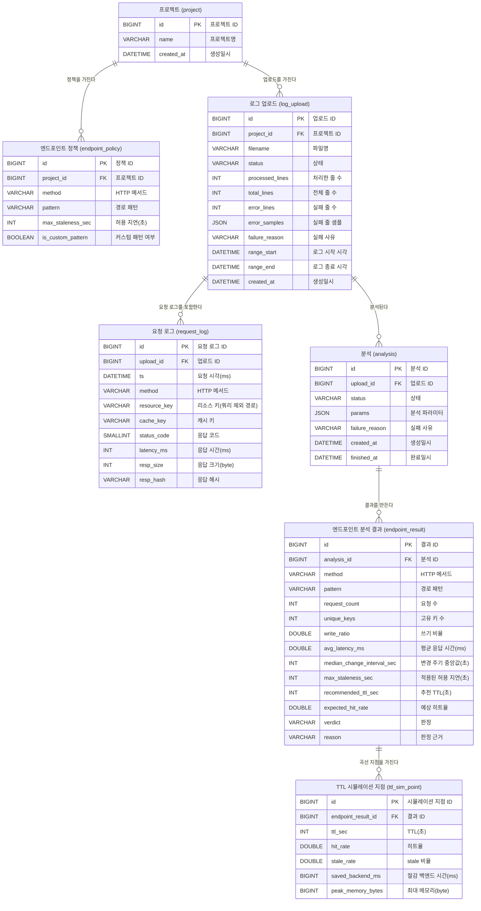

# TTL Advisor — v1 설계

API 액세스 로그를 분석해 엔드포인트별 Redis TTL을 추천하는 서비스.

## 1. 범위

- **v1 포함**: 로그 업로드 → 엔드포인트별 분석 → TTL별 히트율 시뮬레이션 → 추천 TTL + 근거 리포트
- **v1 제외 (v2+)**: 실시간 수집 SDK, 실제 Redis 연동/자동 TTL 적용, 인증·멀티유저, nginx 로그 포맷

## 2. 아키텍처

```
[React + TS (Vite)]
      │  REST (/api), 작업 상태는 폴링
      ▼
[Spring Boot API]
  ├ ingest   : 업로드 → 파싱 → 경로 정규화 → MySQL 배치 저장 (비동기)
  └ analysis : 저장된 로그로 TTL 시뮬레이션 → 추천 계산 → 결과 저장 (비동기)
      │
      ▼
[MySQL 8]  원시 요청 로그 + 분석 결과
```

- 비동기 처리: `@Async` + `ThreadPoolTaskExecutor` (v1은 메시지 큐 없음)
- Redis는 추천 대상일 뿐, v1 런타임 구성에는 포함하지 않음

## 3. 핵심 개념

| 용어 | 의미 | 예시 |
|---|---|---|
| 패턴 (pattern) | 분석·추천 단위 | `GET /users/:id` |
| 캐시 키 (cache key) | 실제 캐시 항목 하나 | `GET /users/123?lang=ko` (쿼리 파라미터 정렬) |
| 리소스 키 (resource key) | 쓰기 무효화 매칭 단위. 쿼리를 뺀 경로 | `/users/123` |

경로 정규화 규칙:
- 숫자 세그먼트 → `:id`, UUID → `:uuid`, 16자 이상 hex → `:hash`
- 사용자가 등록한 커스텀 패턴이 자동 규칙보다 우선
- 패턴은 **분석 시점에** 계산한다 (DB에 저장하지 않음). 커스텀 패턴을 바꾸고 재분석하면 업로드 없이 바로 반영된다

## 4. 입력 로그 포맷 (JSON Lines)

```json
{"ts":"2026-11-23T10:00:00.123Z","method":"GET","path":"/users/123?lang=ko","status":200,"latencyMs":42,"size":1830,"respHash":"a1b2c3"}
```

| 필드 | 필수 | 설명 |
|---|---|---|
| ts | O | ISO-8601, 밀리초 |
| method | O | HTTP 메서드 |
| path | O | 쿼리 포함 경로 |
| status | O | 응답 코드 (GET 2xx만 캐시 대상으로 분석) |
| latencyMs | - | 백엔드 응답 시간 (절감 효과 계산) |
| size | - | 응답 크기 (메모리 추정) |
| respHash | - | 응답 바디 해시. 있으면 실제 데이터 변경을 감지해 stale 비율을 정확히 계산 |

`respHash`가 없으면 같은 리소스에 대한 쓰기 요청(POST/PUT/PATCH/DELETE)을 변경 시점으로 간주한다.

## 5. 분석 알고리즘

준비:
- 분석 시작 시 프로젝트 정책(커스텀 패턴, 허용 staleness)을 `analysis.params`에 **스냅샷**으로 저장하고 이 값만 사용한다 (분석 중·후 정책 변경의 영향 없음)
- 업로드의 요청 로그를 `ts` 순으로 스트리밍하며 패턴을 계산하고 캐시 키별로 그룹화
- 후보 TTL `[1, 5, 10, 30, 60, 120, 300, 600, 1800, 3600, 21600, 86400]`초 중 **로그 기간의 절반을 넘는 값은 제외**하고, 제외 사실을 결과 `reason`에 남긴다

패턴마다, 남은 후보 TTL 각각에 대해:

1. 캐시 키별로 요청을 시간순으로 재생
2. 첫 요청은 miss → 캐시에 저장, 만료 시각 = 현재 + TTL
3. 만료 전 같은 키 요청은 hit. 단, 그 사이 **같은 리소스 키**에 쓰기가 있었으면 무효화되어 miss
   (예: `PUT /products/123`은 `GET /products/123?lang=ko` 캐시를 무효화)
4. hit인데 `respHash`가 캐시된 값과 다르면 stale hit

TTL별 지표:
- `hitRate`, `staleRate`
- `savedBackendMs` — hit 요청 latency 합
- `peakMemoryBytes` — 동시 생존 키 수 최대값 × 평균 응답 크기

추천 규칙:
1. 후보를 `TTL ≤ maxStaleness`(사용자 설정) 이고 `staleRate ≤ 1%` 로 필터
2. 남은 후보 중 최대 히트율의 90%에 처음 도달하는 가장 작은 TTL (곡선의 knee)

판정 (verdict):
- `CACHE` — 위 규칙으로 추천 TTL 결정
- `DONT_CACHE` — 최대 히트율 < 10% 또는 쓰기 비중이 높음
- `INSUFFICIENT_DATA` — 요청 수 부족

## 6. 데이터 모델 (MySQL 8)

스키마는 **Flyway**로 관리한다 (`backend/src/main/resources/db/migration/V1__init.sql` 부터 시작).
JPA는 `ddl-auto=validate` 로 두어 엔티티와 실제 스키마 불일치를 시작 시점에 잡는다.

```
project            (id, name, created_at)
endpoint_policy    (id, project_id, method, pattern, max_staleness_sec, is_custom_pattern)
                    UNIQUE (project_id, method, pattern)
log_upload         (id, project_id, filename, status[UPLOADED|PARSING|PARSED|FAILED],
                    processed_lines, total_lines, error_lines, error_samples JSON,
                    failure_reason, range_start, range_end, created_at)
request_log        (id, upload_id, ts DATETIME(3), method, resource_key, cache_key,
                    status_code, latency_ms, resp_size, resp_hash)
                    INDEX (upload_id, ts)
analysis           (id, upload_id, status[PENDING|RUNNING|DONE|FAILED], params JSON,
                    failure_reason, created_at, finished_at)
endpoint_result    (id, analysis_id, method, pattern, request_count, unique_keys,
                    write_ratio, avg_latency_ms, median_change_interval_sec,
                    max_staleness_sec, recommended_ttl_sec, expected_hit_rate,
                    verdict, reason)
ttl_sim_point      (id, endpoint_result_id, ttl_sec, hit_rate, stale_rate,
                    saved_backend_ms, peak_memory_bytes)
```

### ERD



- `request_log` 적재는 JPA 대신 `JdbcTemplate` 배치 insert (대량 데이터)
- `request_log` 인덱스는 `(upload_id, ts)` 하나. 분석은 업로드 전체를 시간순으로 스트리밍하므로 충분하고,
  긴 문자열 컬럼(`cache_key` 512자)을 인덱스에 넣지 않아 utf8mb4 키 길이 한도(3072바이트) 문제를 피한다
- `endpoint_policy`의 `UNIQUE (project_id, method, pattern)`으로 정책 중복을 DB에서 막는다
- 업로드 1회 제한: 100MB(동기 검사, 413) / 100만 줄(파싱 중 검사, 초과 시 `FAILED`)
- 삭제: 프로젝트 삭제 시 요청 로그는 `upload_id` 단위로 1만 건씩 배치 삭제한다 (FK 연쇄 삭제에 의존하지 않음).
  파싱·분석이 진행 중인 프로젝트는 삭제할 수 없다 (409)

## 7. REST API

요청·응답 형식, 에러 코드 등 상세는 [API.md](API.md) 참고.

```
POST   /api/projects                               프로젝트 생성
GET    /api/projects                               프로젝트 목록
GET    /api/projects/{projectId}                   프로젝트 조회
DELETE /api/projects/{projectId}                   프로젝트 삭제
POST   /api/projects/{projectId}/uploads           로그 업로드 (multipart) → 202
GET    /api/projects/{projectId}/uploads           업로드 목록
GET    /api/uploads/{uploadId}                     업로드 상태 조회
GET    /api/projects/{projectId}/policies          정책 목록
PUT    /api/projects/{projectId}/policies          정책 일괄 저장
POST   /api/uploads/{uploadId}/analyses            분석 실행 → 202
GET    /api/uploads/{uploadId}/analyses            분석 목록
GET    /api/analyses/{analysisId}                  분석 결과 (대시보드)
GET    /api/analyses/{analysisId}/endpoints/{id}   엔드포인트 상세 (곡선)
GET    /api/analyses/{analysisId}/export           추천 설정 내보내기
```

## 8. 백엔드 구조

- Java 21, Spring Boot 4.1, Gradle 9
- Spring Data JPA + JdbcTemplate, Flyway, MySQL Connector/J
- 테스트: `TtlSimulator`/`TtlRecommender` 단위 테스트, Testcontainers(MySQL) 통합 테스트

```
backend/src/main/java/com/ttladvisor/
 ├ project/    controller, service, repository, domain, dto
 ├ ingest/     LogParser(인터페이스), JsonLinesParser, PathNormalizer, UploadService
 ├ analysis/   TtlSimulator, TtlRecommender, AnalysisService
 └ common/     config(Async, CORS), exception, response
backend/src/main/resources/
 ├ application.yml
 └ db/migration/V1__init.sql
```

## 9. 프론트엔드 구조

- Vite + React + TypeScript, React Router, TanStack Query(폴링), Recharts

화면:
1. 프로젝트 목록 / 생성
2. 로그 업로드 — 드래그앤드롭, 파싱 진행률
3. 분석 대시보드 — 엔드포인트별 요청 수, 쓰기 비율, 추천 TTL, 예상 히트율, 판정 표
4. 엔드포인트 상세 — TTL별 히트율·stale 곡선, 추천 지점 표시, 허용 staleness 슬라이더
   (곡선 포인트를 이미 받아오므로 서버 재요청 없이 클라이언트에서 추천값 재계산)

## 10. 저장소 / Docker 구성

```
TTL개인프로젝트/
 ├ backend/          멀티스테이지 Dockerfile (Gradle 빌드 → JRE)
 ├ frontend/         빌드 → nginx 정적 서빙, /api 는 backend로 프록시
 ├ tools/loggen/     Zipf 분포 기반 샘플 트래픽 로그 생성기 (Node + TS)
 ├ docs/DESIGN.md
 └ docker-compose.yml   mysql, backend, frontend
```

- 개발 시: MySQL만 Docker, 백엔드·프론트는 로컬 실행
- 배포/데모 시: `docker compose up` 으로 전체 실행

## 11. 결정 사항

| 항목 | 결정 |
|---|---|
| 원시 로그 저장 | 저장 (파라미터 바꿔 재분석 가능), 업로드당 ~100MB / 100만 줄 제한 |
| v1 로그 포맷 | JSON Lines만 |
| 인증 | v1 없음 |
| 스키마 관리 | Flyway + `ddl-auto=validate` |
| 샘플 로그 생성기 | Node + TS 스크립트 |
| 패턴 계산 시점 | 분석 시점 (재분석으로 커스텀 패턴 반영) |
| 쓰기 무효화 매칭 | 리소스 키(쿼리 제외 경로) 기준 |
| 정책 적용 | 분석 시작 시 스냅샷 |
| 추적용 쿼리 파라미터 제외 (`utm_*` 등) | v2 (정책에 제외 목록 추가) |
